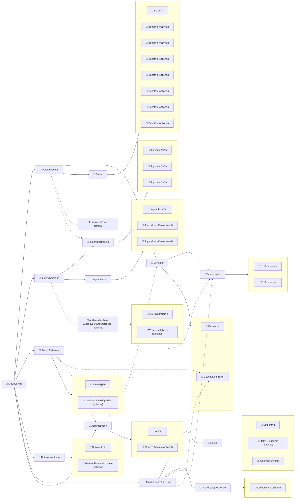
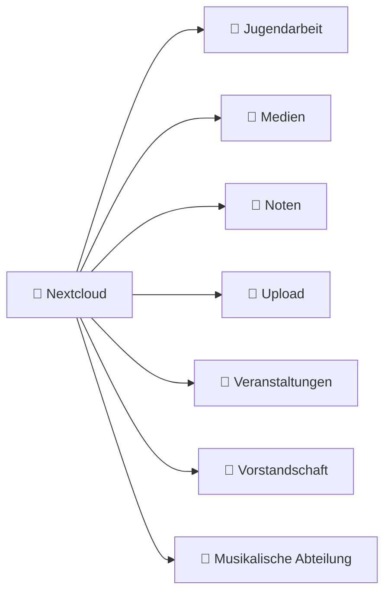

## Gruppen
| Gruppe / Abteilung                         | Rollen / Mitglieder                                                                                  |
|-------------------------------------------|-----------------------------------------------------------------------------------------------------|
| 👥 **Musikverein**                          |                                                                                                     |
| ➡️ 👥 **Vorstandschaft**                   | Vorstand, Beirat, Ehrenvorsitzende (optional)                                                       |
| ➡️ ➡️ 👥 **Vorstand**                       | Vorsitzende, 👤 Kassier\*in, 👤 Geschäftsführer\*in                                                  |
| ➡️ ➡️ ➡️ 👥 **Vorsitzende**                 | 👤 1. Vorsitzende, 👤 2. Vorsitzende                                                               |
| ➡️ ➡️ 👥 **Beirat**                         | 👤 Beirät\*in, 👤 Beirät\*in (optional) x7                                                          |
| ➡️ 👥 **Jugendvorstand**                    | Jugendvertretung, Jugendbeirat, Außerordentliche Jugendvorstandsmitglieder (optional)              |
| ➡️ ➡️ 👥 **Jugendvertretung**               | 👤 Jugendleiter\*in x3                                                                              |
| ➡️ ➡️ 👥 **Jugendbeirat**                   | 👤 Jugendbeirät\*in, 👤 Jugendbeirät\*in (optional) x2                                              |
| ➡️ ➡️ 👥 **Außerordentliche Jugendvorstandsmitglieder** | 👤 Elternvertreter\*in, 👤 Weitere Mitglieder (optional)                               |
| ➡️ 👥 **Public Relations**                  | 👤 PR-Mitglied, 👤 Geschäftsführer\*in, 👤 Weitere PR-Mitglieder (optional), Vorsitzende, Administration |
| ➡️ 👥 **Notenverwaltung**                   | 👤 Notenwärt\*in, 👤 Weitere Notenwärt\*innen (optional)                                            |
| ➡️ 👥 **Musikalische Abteilung**            | 👤 Geschäftsführer\*in, Dirigat, Orchestersprechende, Vorsitzende                                   |
| ➡️ ➡️ 👥 **Dirigat**                        | 👤 Dirigent\*in, 👤 Stellv. Dirigent\*in (optional), 👤 Jugenddirigent\*in                            |
| ➡️ ➡️ 👥 **Orchestersprechende**           | 👤 Orchestersprecher\*in                                                                           |
| ➡️ 👥 **Administration**                    | 👤 Admin, 👤 Weitere Admins (optional), Vorstand                                                    |

Gruppen für Nextcloud und andere Dienste (welche im [IdP](https://en.wikipedia.org/wiki/Identity_provider) authentik angelegt werden).

<details>
<summary>Gruppen-Graph</summary>



</details>

## Nextcloud Team Folders
<details>
<summary>Ordner-Graph</summary>



</details>

### Jugendarbeit

| Group          | Read | Write | Share | Delete |
|----------------|------|-------|-------|--------|
| Jugendvorstand | 👀   | ✏️    | 🔗    | 🗑️     |
| Vorstand       | 👀   | ✏️    | 🔗    | 🗑️     |

### Medien

| Group            | Read | Write | Share | Delete |
|------------------|------|-------|-------|--------|
| Public Relations | 👀   | ✏️    | 🔗    | 🗑️     |
| Vorstandschaft   | 👀   | ✏️    | 🔗    | 🗑️     |
| Jugendvorstand   | 👀   | ✏️    | 🔗    | 🗑️     |

### Noten

| Group                  | Read | Write | Share | Delete |
|------------------------|------|-------|-------|--------|
| Notenverwaltung        | 👀   | ✏️    | 🔗    | 🗑️     |
| Musikalische Abteilung | 👀   | ✏️    | 🔗    | 🗑️     |

### Upload

| Group            | Read | Write | Share | Delete |
|------------------|------|-------|-------|--------|
| Vorstand         | 👀   | ❌    | ❌    | 🗑️     |
| Jugendvertretung | 👀   | ❌    | ❌    | 🗑️     |
| Administration   | 👀   | ❌    | ❌    | 🗑️     |

### Veranstaltungen

| Group          | Read | Write | Share | Delete |
|----------------|------|-------|-------|--------|
| Vorstandschaft | 👀   | ✏️    | 🔗    | 🗑️     |

### Vorstandschaft

| Group          | Read | Write | Share | Delete |
|----------------|------|-------|-------|--------|
| Vorstandschaft | 👀   | ✏️    | 🔗    | 🗑️     |

### Musikalische Abteilung

| Group                  | Read | Write | Share | Delete |
|------------------------|------|-------|-------|--------|
| Musikalische Abteilung | 👀   | ✏️    | 🔗    | 🗑️     |


## Usage / Developer

### Prerequisites
- OpenTofu (the `tofu` CLI) or Terraform-compatible client installed and on `PATH`.
- `direnv` installed and enabled in your shell.
- An Authentik account with an API token that has permission to manage users/groups and other resources used by this repo.

### User YAML (`env/users/mva.yaml`)

The users are defined in `env/users/mva.yaml` as a YAML list. This file is intentionally not committed to
avoid leaking real email addresses and personal data (and to prevent accidental spam). Keep a local copy
at `env/users/mva.yaml` or store it in a private location and load it via your `.envrc` if needed.

Example entry (minimal):

```yaml
- name: "Vor Name"
    # optional, generated from `name` if missing
    username: "v.name"
    # optional, defaults to <username>@mv-angelbachtal.de
    email: "v.name@mv-angelbachtal.de"
    # group identifiers refer to `authentik_group` resource names (keys)
    groups:
        - Vorstand
        - Musikverein
    attributes:
        role: "Probenclown"
```

Guidelines:
- Use the `name` field (first + last name) — `username` and `email` will be derived if omitted.
- `groups` should reference the group keys used by the Terraform `authentik_group` resources.
- Do not commit `env/users/mva.yaml` with real personal data.

### Local setup
- Create a small file containing the token at `~/.config/authentik/mva.env`, for example:

```bash
export AUTHENTIK_TOKEN="<your-authentik-api-token>"
```

- Create a `mva.yaml` file at `env/users` containing the users.
- The repository contains a `.envrc` that sources `~/.config/authentik/mva.env`. Allow direnv:

```bash
direnv allow
```

### Typical workflow
- Initialize and validate the plan:

```bash
cd /home/jan/tofu/authentik-mva
tofu init
tofu plan
```

- Apply changes:

```bash
tofu apply
```

Notes
- User data lives in `env/users/mva.yaml`.
- GUI-managed nested attributes (e.g. `contact`, `settings`) are intentionally ignored by the Terraform resources in this repo to avoid overwriting user-entered values.
